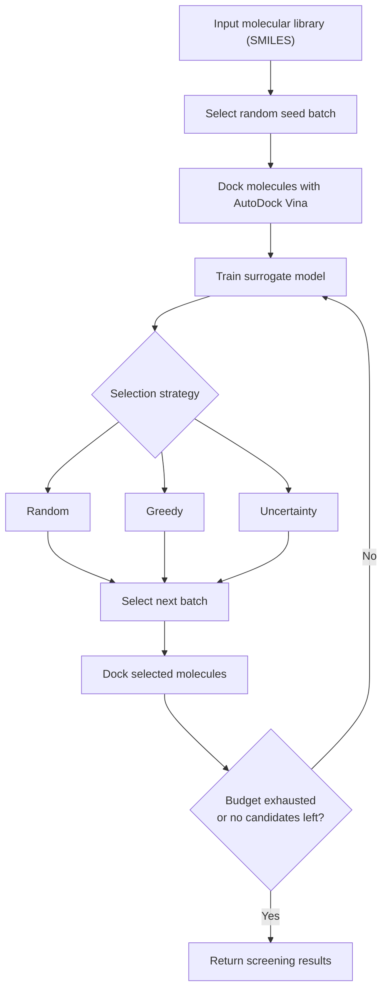

# silicadd — Active Learning for Virtual Screening

**silicadd** is a Python toolkit for active-learning-driven virtual screening with AutoDock Vina. It combines molecular featurization, a machine-learning surrogate model, configurable molecule-selection strategies, and a docking engine in a reproducible screening workflow.

Instead of docking every molecule in a library immediately, the workflow starts with a seed batch, learns from the resulting docking scores, and selects subsequent molecules using one of three strategies:

- **Random:** selects candidates without using model rankings.
- **Greedy:** prioritizes candidates with the best predicted scores.
- **Uncertainty:** uses predicted scores and model uncertainty to guide selection.

The project also provides docking-result caching, pose-level retrieval, and benchmarking against a global top-*k* reference when sufficiently complete reference data are available.

**Scientific scope:** The workflow evaluates computational docking scores and screening strategies. Docking scores are not experimental binding affinities, and benchmark recovery does not establish biological activity.

## Workflow


---

## Installation

```bash
python -m venv .venv
source .venv/bin/activate          # Windows: .venv\Scripts\activate
pip install -r requirements.txt
```

`requirements.txt` installs:

| Package | Purpose |
| --- | --- |
| `rdkit` | Molecule parsing, Morgan fingerprints, 3D conformer generation |
| `numpy`, `pandas`, `scikit-learn` | Features, results, random-forest surrogate |
| `pytest` | Test suite |
| `vina` | The official AutoDock Vina Python API |
| `meeko` | Ligand preparation (SMILES → PDBQT) |
| `gemmi` | Required to import `meeko` (it declares no dependencies of its own) |

### Vina prerequisites

The `vina` wheel bundles the AutoDock Vina C++ engine, so no separate Vina
installation is needed. **The receptor, however, must be prepared separately** —
this engine docks against a *prepared* PDBQT receptor and does not prepare
proteins itself.

A typical receptor preparation:

```bash
# 1. Add hydrogens and fix missing atoms/residues (e.g. with PDBFixer, reduce,
#    pdb2pqr, ...), then convert to PDBQT:
prepare_receptor -r receptor.pdb -o receptor.pdbqt -A hydrogens
```

Any tool that writes a rigid receptor PDBQT works. Meeko's own receptor
tooling (`PDBQTReceptor`) can also be used.

---

## Quick start: the docking engine on its own

```python
from silicadd import VinaDockingEngine

engine = VinaDockingEngine(
    receptor_pdbqt="prepared_receptor.pdbqt",   # a PREPARED receptor
    box_center=(12.5, 4.0, -3.2),               # binding-site centre, Å
    box_size=(22.0, 20.0, 22.0),                # box dimensions, Å
    exhaustiveness=8,
    seed=42,
)

affinity = engine("CCO")     # Vina affinity in kcal/mol (more negative = better)
```

The box centre and dimensions are **required**. The engine never guesses a
target, a binding site or a box.

---

## Getting the poses, not just the score

`dock_pdbqt_poses` is the pose-level counterpart of `dock_pdbqt`. Where the
latter collapses a run to a single affinity, this one keeps the geometry of
every pose, so a prediction can be compared against an experimental
structure — for example to measure the RMSD of a redocked pose against the
co-crystallised ligand.

```python
poses = engine.dock_pdbqt_poses(engine.prepare_ligand_pdbqt("CCO"))

for pose in poses:
    print(pose.affinity, pose.mol.GetNumConformers())
```

Each pose is a `DockedPose` carrying its affinity in kcal/mol and an RDKit
molecule holding the docked coordinates. The reconstruction keeps the atom
order of the molecule the ligand was prepared from, so two poses of the same
molecule can be compared by substructure matching and RMSD without
renumbering by hand.

By default only the poses within Vina's own `energy_range` (3 kcal/mol of the
best) are reported — the same set `dock_pdbqt` scores. Pass a larger
`energy_range` to keep the weaker poses as well.

---

## Quick start: the engine inside the active learning loop

```python
from silicadd import VinaDockingEngine, run_active_loop

engine = VinaDockingEngine(
    receptor_pdbqt="prepared_receptor.pdbqt",
    box_center=(12.5, 4.0, -3.2),
    box_size=(22.0, 20.0, 22.0),
    exhaustiveness=8,
    n_poses=9,
    seed=42,
)

results = run_active_loop(
    smiles_list=library,                 # list of SMILES strings
    seed_size=5,                         # molecules docked in the seed batch
    batch_size=5,                        # molecules selected per iteration
    docking_budget=100,                  # maximum number of docking operations
    strategy="uncertainty",              # "random" | "greedy" | "uncertainty"
    docking_function=engine,             # the engine is the docking function
    random_state=42,
    docking_config=engine.config_settings(),   # keys the cache by setup
    cache_path="vina_cache.json",               # optional, needs docking_config
)

print(results)
```

`results` is a `pandas.DataFrame` with one row per molecule and the columns
`smiles`, `canonical_smiles`, `predicted_score`, `true_score`,
`prediction_uncertainty`, `iteration`, `strategy`, `validation_status` and
`docking_call`.

### Where the box coordinates come from

The `box_center` must be the centre of the binding site and `box_size` its
extent, in Ångström. Get them from the structure of your target:

* from a known ligand in the co-crystal structure — centre the box on the
  ligand's centroid and size it to cover the pocket;
* from a residue or pocket centre reported by a site-detection tool
  (e.g. `p2rank`, `fpocket`);
* from the coordinates of the co-crystallised partner in the PDB entry.

For example, if a co-crystallised ligand sits at `(12.5, 4.0, -3.2)` and the
pocket is about 22 Å across:

```python
box_center=(12.5, 4.0, -3.2)
box_size=(22.0, 20.0, 22.0)
```

A box that is too small will clip the ligand out of the search space and give
meaningless affinities; a box that is too large costs a great deal of compute
and dilutes the search. 20–25 Å per side is a common starting point for a
small-molecule pocket.

---

## Score convention

Vina reports a binding affinity in kcal/mol, negative for favourable binding.
The active learning loop ranks on **lower is better**, so the Vina affinity is
used **unchanged** — no rescaling, no sign flip. A Vina affinity of `-7.2`
kcal/mol is simply a better score than `-4.8` kcal/mol throughout the loop, the
surrogate model and the benchmark metrics.

**Interpretation and limitations:** Vina scores are approximate computational scoring estimates, not experimentally measured binding affinities. A more negative score indicates a more favorable score under the chosen docking setup, but does not by itself demonstrate stronger experimental binding or biological activity. Comparisons are most meaningful when molecules are evaluated using consistent receptor preparation, binding-site coordinates, box dimensions, and docking settings.

---

## Failure handling

The engine **never substitutes a synthetic score**. Every failure raises
`VinaDockingError`:

| Failure | Raised as |
| --- | --- |
| Receptor PDBQT missing or not a PDBQT file | `VinaDockingError` at construction |
| SMILES RDKit cannot parse | `VinaDockingError` |
| No 3D conformer could be generated | `VinaDockingError` |
| Meeko could not prepare the ligand | `VinaDockingError` |
| Vina could not load the receptor or compute the maps | `VinaDockingError` |
| The docking run failed or produced no usable pose | `VinaDockingError` |

Invalid *arguments* (a malformed box, a bad exhaustiveness) raise `ValueError`
at construction time.

This matters because the active learning loop catches docking exceptions and
records the molecule with `validation_status == "failed"` and a `NaN` true
score — it is never used as a training label. A fabricated placeholder score
would silently poison the surrogate model instead.

---

## Performance notes

Preparing the receptor and computing the Vina affinity maps are the expensive
parts of a campaign, and both depend only on the receptor and the box — not on
the ligand. The engine therefore prepares them **once** and reuses them for
every molecule.

Call `engine.warm_up()` to force that setup up front. It moves the cost out of
the first docking attempt, so a bad receptor or an impossible box is reported
immediately rather than on the first molecule of a long run.

The engine holds mutable state and is **not thread-safe**: give each thread its
own engine.

---

## Benchmarking the strategies

```python
from silicadd import benchmark_strategies

frame = benchmark_strategies(
    smiles_list=library,
    k=10,
    seed=42,
    strategies=["random", "greedy", "uncertainty"],
    budgets=[10, 25, 50, 100],
    docking_function=engine,
    verbose=False,
)
```

The ground truth is established either from a supplied `reference_scores`
mapping or by exhaustively docking the whole eligible library. It is used for
evaluation only and is never handed to a strategy. When the reference does not
cover the complete eligible library, the top-k recovery metrics are reported as
unavailable (`NaN`, with `recovery_metrics_valid == False`) rather than
computed from a partial set.

### Interpreting benchmark results

Benchmark results depend on the molecular library, docking setup, selection strategy, and docking budget. Top-*k* recovery measures how effectively a strategy identifies molecules with the best reference docking scores within the available budget; it does not measure experimentally confirmed hit discovery. Runtime and docking-call counts provide complementary measures of computational effort.

---

## Tests

```bash
python -m pytest src/silicadd/tests/ -v
```

The suite covers the active learning loop, the cache, the benchmark metrics and
the Vina engine. The Vina and Meeko interfaces are **mocked**, so the tests
need neither a receptor, nor network access, nor a real docking run.

---

## Repository layout

```
src/silicadd/
    active_screener.py     # the active learning loop, cache and benchmark
    vina_docking.py        # the AutoDock Vina docking engine
    __init__.py            # public API
    tests/
        test_active_screener.py
        test_vina_docking.py
        test_vina_docking_poses.py
```
